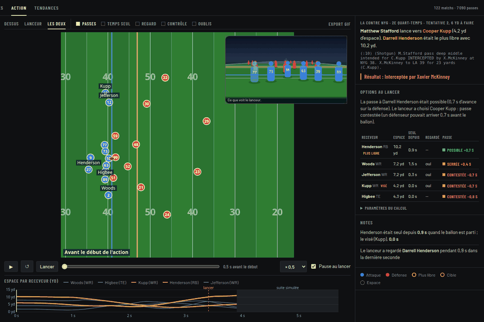
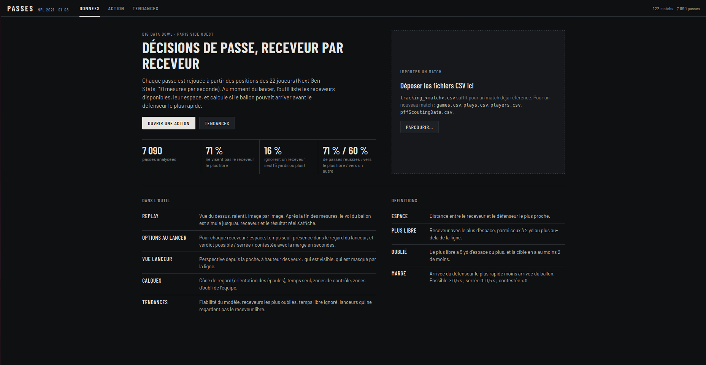
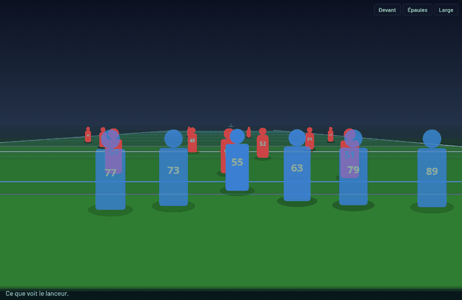
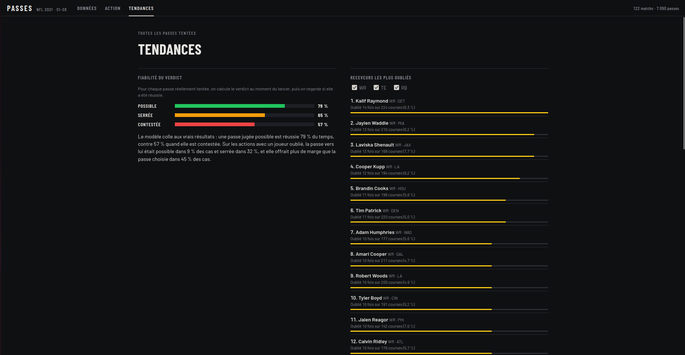
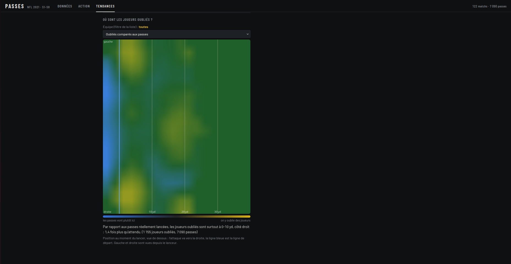

# Passes NFL : le receveur oublié

Un outil d'analyse qui rejoue chaque passe NFL à partir du tracking Next Gen Stats et dit, **pour chaque receveur (WR, TE, RB), si la passe était possible**. Réalisé en 3 heures au NFL Big Data Bowl, Paris Side Quest (AWS × NFL, Epitech, 21 octobre 2026).

> **Sur 7 090 passes, 16 % ignorent un receveur seul à 5 yards ou plus.** Il est seul depuis 1,1 s en médiane, et une fois sur deux le quarterback n'a jamais tourné les épaules vers lui.



*Stafford vise Cooper Kupp (passe contestée, −0,7 s) : interceptée. Darrell Henderson était seul à 10 yards, passe possible (+0,7 s).*

---

## Fonctionnalités

| Page | Fonctionnalité | Description |
|------|----------------|-------------|
| **Action** | Replay vue du dessus | Positions réelles des 22 joueurs à 10 images/s ; lecture/pause (barre d'espace), ralenti ×0,25 / ×0,5 / ×1, image par image, pause automatique au lancer |
| **Action** | Suite simulée | Les mesures s'arrêtent 0,5 s après le lancer : le vol du ballon (avec sa hauteur) est simulé jusqu'au receveur, puis le **résultat réel** s'affiche (réception et yards, passe ratée, interception avec le nom de l'intercepteur) |
| **Action** | Options au lancer | Pour chaque receveur : espace, temps seul, présence dans le regard du lanceur, verdict **possible / serrée / contestée** avec la marge en secondes ; un clic dessine la trajectoire et le défenseur le plus rapide |
| **Action** | Paramètres du calcul | Vitesse du ballon (14 à 26 yd/s) et des défenseurs (6 à 10 yd/s) réglables, recalcul instantané côté Python |
| **Action** | Vue 3D du lanceur | Modes Dessus / Lanceur / Les deux ; caméra Devant, Épaules ou Large ; « Henderson est à 15 yd, caché derrière 1 joueur » |
| **Action** | Courbe d'espace | Espace de chaque receveur seconde par seconde, ligne du lancer, partie simulée grisée |
| **Action** | Calques | Passes (trajectoires colorées par verdict), Temps seul (chrono « seul depuis »), Regard (cône ±30°), Contrôle (zones, mode « plus proche » ou « arrive en premier »), Oublis (carte de l'équipe) |
| **Action** | Filtres et liste | Match, équipe en attaque, « receveur oublié uniquement », oublis d'un joueur ; tri chronologique pour un match, par oubli le plus flagrant sinon |
| **Action** | Export GIF | Téléchargement de l'action en GIF animé (ralenti, pause au lancer), mis en cache |
| **Action** | Liens directs | `#<gameId>-<playId>`, suffixes `-lancer`, `-fin`, `-f<image>` ; `?vue=3d` ou `?vue=both` ; `?on=gaze,zones` pour activer des calques |
| **Données** | Import glisser-déposer | `tracking_<match>.csv` (et `games` / `plays` / `players` / `pffScoutingData.csv` pour un nouveau match) : colonnes vérifiées, fusion sans doublon, recalcul en ~15 s |
| **Données** | Chiffres clés et définitions | Résultats principaux et lexique (espace, plus libre, oublié, marge) |
| **Tendances** | Fiabilité du verdict | Taux de réussite des passes réelles selon le verdict du modèle |
| **Tendances** | Receveurs les plus oubliés | Classement WR / TE / RB ; un clic ouvre leurs actions |
| **Tendances** | Temps libre ignoré | Joueurs et quarterbacks qui laissent le plus de secondes de liberté |
| **Tendances** | Regard du lanceur | Quarterbacks qui ne regardent pas le receveur libre |
| **Tendances** | Où sont les oubliés ? | Carte de chaleur par équipe (oubliés, passes, ou comparaison), avec une phrase de synthèse automatique |

---

## Résultats

| Mesure | Valeur |
|--------|--------|
| Passes analysées | **7 090** (122 matchs, saison 2021, semaines 1 à 8) |
| Passes qui ne visent pas le receveur le plus libre | **71 %** |
| Passes qui ignorent un receveur seul (≥ 5 yd) | **16 %** (1 155 actions) |
| Réussite vers le plus libre / vers un autre | **71 % / 60 %** (9,1 / 7,3 yards en moyenne) |
| Temps seul du receveur oublié au lancer | **1,1 s** en médiane, plus d'1 s dans 57 % des cas |
| Receveur oublié jamais dans le regard (dernière seconde) | **50 %** |
| Réussite selon le verdict : possible / serrée / contestée | **79 % / 65 % / 57 %** (994 / 2 935 / 3 161 passes) |
| Passes vers l'oublié : possibles / plus de marge que la passe choisie | 9 % / 45 % |
| Receveur visé retrouvé dans le texte de l'action | 94 % des passes tentées |

---

## Démo

[](assets/demo_application.webm?raw=true)

▶ **[Vidéo de démonstration (WebM, 10 Mo)](assets/demo_application.webm?raw=true)**

| La même action, vue par le quarterback | Tendances | Où sont les oubliés ? |
|---|---|---|
|  |  |  |

---

## Installation

```bash
python3 -m venv .venv && .venv/bin/pip install -r requirements.txt
./download_data.sh              # ~830 Mo de données dans data/ (122 matchs)
.venv/bin/python server.py      # http://localhost:5000
```

### Options

```bash
.venv/bin/python server.py 5001        # autre port
.venv/bin/python main.py               # régénère les chiffres et graphiques dans outputs/
.venv/bin/python prototypes/make_gifs.py   # régénère les GIF d'actions dans outputs/
```

Au premier lancement, les tables dérivées sont calculées (~1 min) puis mises en cache dans `data/cache/`.

---

## Prérequis

- **Python 3.11+** (testé avec 3.12) : pandas, numpy, matplotlib, pillow, scipy, flask (`requirements.txt`)
- **~1 Go d'espace disque** pour les données et **~2 Go de RAM**
- Un navigateur récent ; une connexion internet pour la police (sinon police système)
- Données : [nfl-big-data-bowl-regional-event-data](https://github.com/ThompsonJamesBliss/nfl-big-data-bowl-regional-event-data) (tracking NFL Next Gen Stats, scouting PFF)

---

## Méthode et limites

| Notion | Définition |
|--------|------------|
| Espace | Distance (yd) entre un receveur et le défenseur le plus proche, image par image ; coordonnées normalisées (`playDirection`), attaque vers la droite |
| Plus libre | Receveur avec le plus d'espace au lancer, parmi ceux à 2 yd ou plus au-delà de la ligne de départ |
| Oublié | Le plus libre a 5 yd d'espace ou plus, n'est pas visé, et la cible en a au moins 2 de moins |
| Passe possible | Ballon en ligne droite à 20 yd/s vers le meilleur point de la course du receveur ; défenseurs : 0,3 s de réaction puis 8 yd/s (ou leur vitesse si plus élevée). Marge = arrivée du défenseur le plus rapide − arrivée du ballon : possible ≥ 0,5 s, serrée 0 à 0,5 s, contestée < 0 |
| Regard | Cône de ±30° dans la direction des épaules (orientation `o`) : le buste, pas les yeux |
| Suite simulée | Joueurs sur leur lancée en ralentissant, ballon en parabole ; seul le résultat affiché est réel |
| Cible | Extraite de `playDescription` puis rapprochée des joueurs de l'action |
| Limites | Corrélations, pas causes ; pression subie par le quarterback et hauteur réelle du ballon non modélisées ; sacks et courses du quarterback exclus |

---

## Structure du dépôt

```
README.md
requirements.txt                 # Dépendances Python
download_data.sh                 # Télécharge les 122 matchs dans data/
main.py                          # Recalcule les chiffres et graphiques (outputs/)
common.py                        # Chargement, normalisation du sens du jeu, espace au lancer, cible
passing.py                       # Modèle « la passe était-elle possible ? » + validation
backend.py                       # Données partagées, payload d'une action, suite simulée
server.py                        # Serveur Flask : API, import glisser-déposer, chargement des extensions
features/                        # Extensions côté serveur (Blueprints Flask, chargées automatiquement)
  passing.py                     #   /api/passing : options au lancer, validation du modèle
  free_time.py                   #   /api/free_time : temps seul, classements
  gaze.py                        #   /api/gaze : regard du lanceur
  heatmap.py                     #   /api/heatmap : carte des oublis
  export.py                      #   /api/export : action en GIF animé
web/                             # Interface (sans framework)
  index.html                     #   Pages Données, Action, Tendances
  style.css
  app.js                         #   Replay, rapport, calques, import, API d'extension window.GT
  features/                      #   Extensions côté navigateur (chargées automatiquement)
    qb_view.js                   #     Vue 3D du lanceur
    gaze.js                      #     Cône de regard
    free_time.js                 #     Chrono « seul depuis »
    zones.js                     #     Zones de contrôle
    heatmap.js                   #     Carte des oublis
prototypes/
  ghost_targets.py               # Première analyse : receveur oublié, classement, image d'une action
  make_gifs.py                   # Génère les GIF d'actions
outputs/                         # GIF, captures, classements (CSV) utilisés dans ce README
assets/                          # Vidéo de démonstration et captures de l'application
data/                            # Données et cache (créé par download_data.sh, ignoré par git)
```
