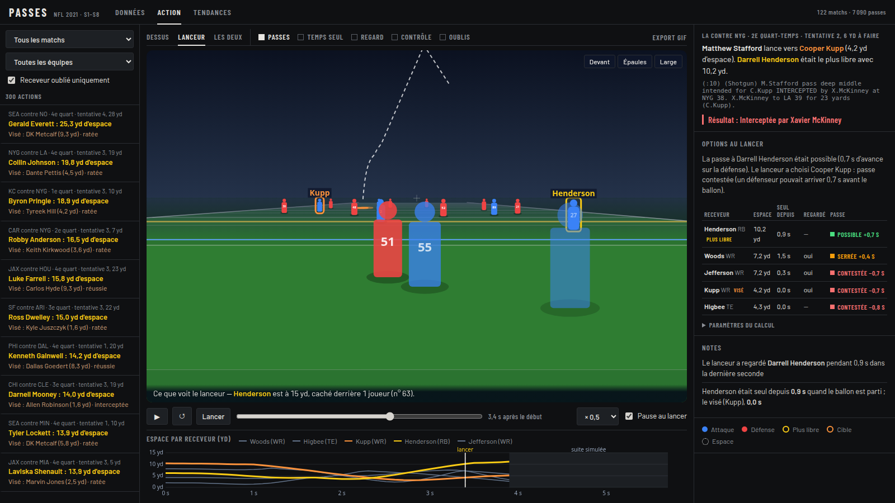
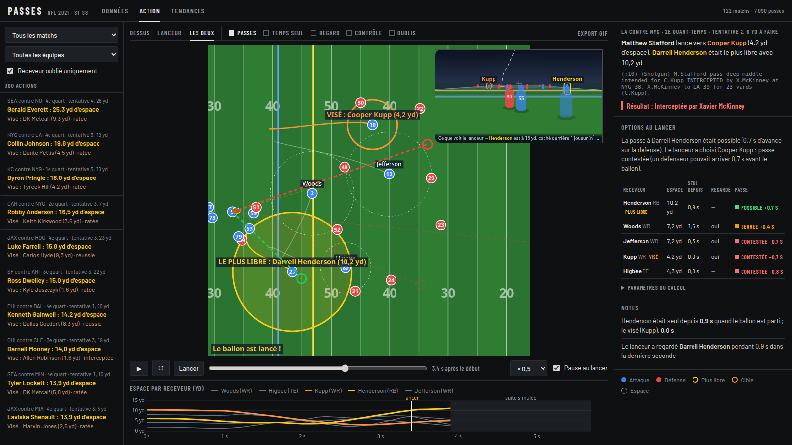
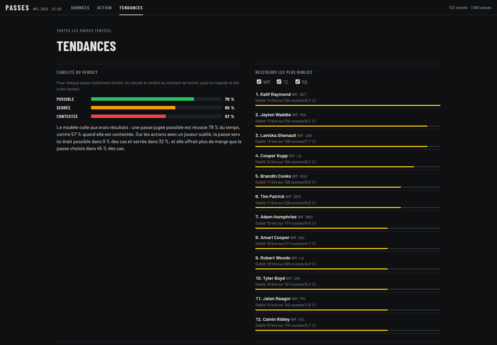

# Passes NFL : le receveur oublié

**Sur 7 090 passes NFL, 16 % ignorent un receveur seul à 5 yards ou plus. Il est seul depuis 1,1 s en médiane, et une fois sur deux le quarterback n'a jamais tourné les épaules vers lui.**

- **L'outil** rejoue chaque passe à partir du tracking (22 joueurs, 10 mesures/s), vue du dessus et **en 3D depuis les yeux du quarterback**, puis prolonge l'action jusqu'au résultat réel.
- **L'originalité** : un verdict « passe **possible / serrée / contestée** » pour **chaque receveur** (vol du ballon contre course du défenseur le plus rapide), pas seulement pour le plus libre.
- **La preuve** : quand le modèle dit « possible », la passe réelle est réussie à **79 %** ; quand il dit « contestée », à **57 %**.
- **Pour qui** : le coach revoit chaque décision de son quarterback option par option ; le commentateur l'explique en 3D, en un clic.

```bash
python3 -m venv .venv && .venv/bin/pip install -r requirements.txt && ./download_data.sh && .venv/bin/python server.py   # puis http://localhost:5000
```


*Stafford vise Cooper Kupp (passe contestée, −0,7 s) : **interceptée**. Darrell Henderson était seul à 10 yards, passe possible (+0,7 s). Suite simulée après la fin des mesures, résultat réel.*

| Vue 3D du quarterback | Options au lancer | Tendances |
|---|---|---|
|  |  |  |

<details>
<summary><b>Méthode, hypothèses et limites</b></summary>

- **Espace** : distance entre un receveur (WR, TE, RB) et le défenseur le plus proche, image par image.
- **Plus libre** : le receveur qui a le plus d'espace au lancer, parmi ceux à 2 yards ou plus au-delà de la ligne de départ. **Oublié** : il a 5 yards d'espace ou plus, et la cible en a au moins 2 de moins. Résultat : 71 % des passes ne visent pas le plus libre, 16 % ignorent un receveur seul ; viser le plus libre donne 71 % de passes réussies contre 60 %.
- **Passe possible** : ballon en ligne droite à 20 yd/s vers le meilleur point de la course du receveur ; chaque défenseur réagit en 0,3 s puis court à 8 yd/s (ou plus vite s'il court déjà). Marge = arrivée du défenseur le plus rapide − arrivée du ballon : possible ≥ 0,5 s, serrée 0 à 0,5 s, contestée < 0. Paramètres réglables dans l'outil.
- **Validation** (passe réellement tentée) : 79 % de réussite si « possible » (994 passes), 65 % si « serrée » (2 935), 57 % si « contestée » (3 161).
- **Regard** : cône de ±30° dans la direction des épaules (orientation `o`), donc le buste et pas les yeux.
- **Suite simulée** : les mesures s'arrêtent 0,5 s après le lancer ; les joueurs continuent ensuite sur leur lancée et seul le résultat affiché est réel.
- **Cible** : extraite du texte de l'action, retrouvée pour 94 % des passes tentées.
- **Limites** : corrélations, pas causes ; ni la pression subie par le quarterback ni la hauteur du ballon ne sont modélisées.
</details>

<details>
<summary><b>Code et fonctionnalités</b></summary>

- `common.py` : chargement, normalisation du sens du jeu, espace au lancer, cible.
- `passing.py` : modèle « passe possible » (par action et sur toutes les passes, avec validation).
- `backend.py`, `server.py` : backend Python (Flask) et API, suite simulée, import de fichiers par glisser-déposer ; `features/` : temps seul, regard, carte des oublis, passes, export GIF.
- `web/` : interface (Données, Action, Tendances) ; `web/features/` : vue 3D, regard, temps seul, zones de contrôle, carte des oublis.
- `prototypes/ghost_targets.py` : premiers chiffres et graphiques ; `main.py` les régénère dans `outputs/`.
</details>
